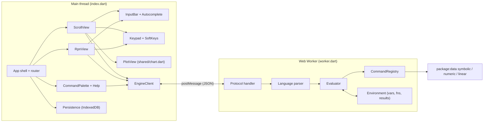
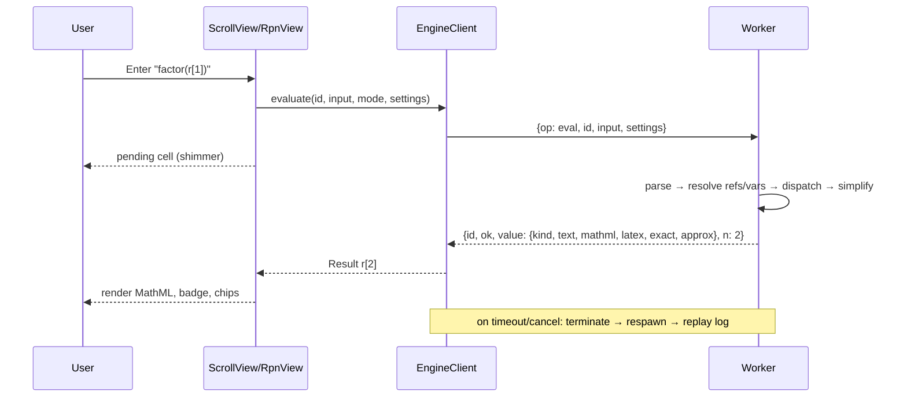
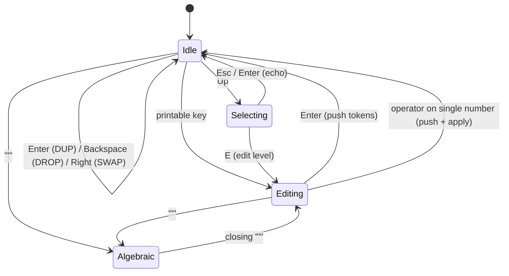
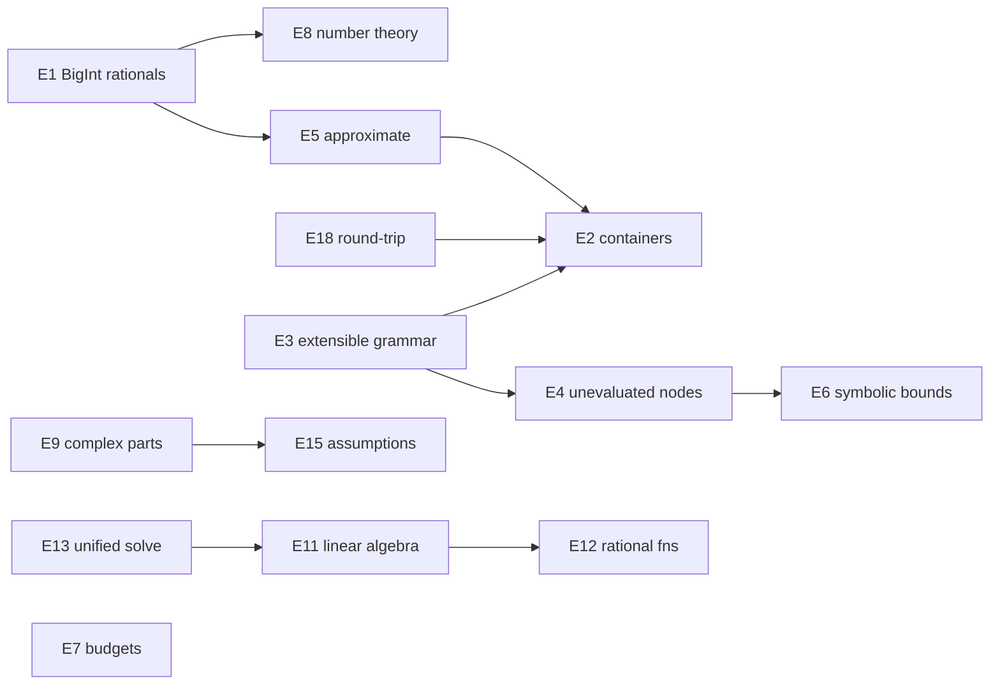

# Symbolic Calculator PWA — Design Document

Status: Draft · Target: `web/calculator/` · Depends on: `package:data/symbolic.dart`, `package:data/numeric.dart`, `package:data/linear.dart`, `web/shared/`

---

## 1. Summary

A dark-glass, installable Progressive Web App that turns the `package:data` symbolic engine into a computer algebra calculator. It has two interaction modes on one shared engine:

- **Scroll mode**: a notebook-like worksheet. Every evaluated input produces a numbered result `r[n]` that later inputs can reference.
- **RPN mode**: an HP48-style stack machine with an interactive stack, a command line, and paged soft-key menus.

Results are exact and symbolic by default (rationals, `π`, `e`, `i`, radicals, matrices of expressions). Numeric approximations can be requested per result or globally. All features are reachable from the keyboard, touch keypad, command palette, and context-aware action chips.

### 1.1 Goals

| ID | Goal |
| --- | --- |
| G1 | Exact symbolic computation by default, with numeric results always one action away. |
| G2 | Two modes (Scroll, RPN) that share values, variables, and settings. |
| G3 | Fully keyboard operable on desktop, and fully touch operable on mobile, from 360 px wide up. |
| G4 | Features you can discover without docs: command palette, autocomplete with signatures, action chips, inline help. |
| G5 | Visual parity with `web/expressions` and `web/distributions`: shared tokens, glass cards, MathML rendering. |
| G6 | Works offline once installed (PWA), and keeps history across sessions. |
| G7 | Heavy computations never freeze the UI and can be cancelled. |

### 1.2 Non-Goals (v1)

- Arbitrary-precision floating point (numeric results use IEEE double).
- Symbolic ODE solving, assumptions engine, 3D/surface plotting.
- Programmable user programs (HP48 `« »` RPL programs). Section 9 lists this as a later extension.
- Cloud sync and collaboration.

---

## 2. Current State Analysis

### 2.1 Reusable Assets

| Asset | Location | Reuse |
| --- | --- | --- |
| Design tokens, sidebar, cards, badges, buttons, inputs, copy toast | `web/shared/style.css` | Imported verbatim. Calculator-specific rules go in `web/calculator/style.css`. |
| Canvas plotting (`PlotViewport`, `drawGrid`, `drawCurve`, `drawPointMarker`, `drawCrosshairAndTooltip`, `drawShadedInterval`) | `web/shared/chart.dart` | Inline and full-screen plots. |
| Copy/clipboard helpers, MathML setters (`setAttrExpr`), number formatting | `web/shared/utils.dart` | Result rendering and copying. |
| Formula bar styling (`.formula-input-bar`, status badges, parse error line) | `web/expressions/style.css` | Moved to `web/shared/style.css` so both apps share it. |
| Integer factorization (`factorIntegerExpr`), complex formatting | `web/expressions/algebra.dart` | Moved into core (see E8). |

### 2.2 Engine Capabilities Available Today

- Parsing: `Expr.parse` / `Expr.tryParse` (precedence, relational ops, constants, elementary and special functions, `piecewise`, `O(...)`).
- Exact numbers: `RationalNumber`, `ConstantNumber` (`π`, `e`, `i`, `∞`), complex numbers as `a + b*i`; `RealNumber` only when you type a decimal literal.
- Algebra: `simplify()`, `expand()`, `factor()` (multivariate GCD, univariate over ℚ\[x\]).
- Calculus: `derivative(v, order:)`, `integrate(v, from:, to:)` (definite bounds as `num` only), `series(v, point:, order:)`, `taylorSeries(v, around:, order:)`, `limit(v, point, direction:)`, `gradient`, `hessian`, `jacobian`.
- Solving: `solve(v)` (polynomials up to degree 4, rational, transcendental, Lambert W), `solveSystem` (linear), `solvePolynomialSystem` (resultants, Gröbner + FGLM).
- Linear algebra on `Matrix<Expr>`: `determinant()`, `characteristicPolynomial()`, `inverse()`, `derivative(v)`; generic `Matrix` arithmetic through `ExprField`.
- Output: `toString()`, `toLatex()`, `toMathMl()`.
- Numeric bridge: `toFunction1D`, `toComplexFunction1D`, `toVectorFunction`, `evaluate`, `evaluateComplex`; numeric `integrate`, `solve`, `derivative`, `minimize`, `linearSpaced`.

### 2.3 Gaps That Block or Limit the Calculator

The main gaps are summarized here and specified in Section 8:

1. `RationalNumber` is backed by `int`. Under dart2js, `int` is a JS double, so exact arithmetic silently loses precision above 2⁵³ (`25!`, `2^64`). This breaks the exact-by-default promise on the web.
2. No matrix or vector literals in the grammar, and no textualization (`toMathMl`, `toLatex`) for `Matrix<Expr>` / `Vector<Expr>`.
3. The grammar is closed. The app cannot add `r[n]`, `:=`, or matrix syntax without forking the parser, and unknown function names throw.
4. There is no partial numeric evaluation (`N[...]`) that returns an `Expr`. `evaluate` requires every variable bound and returns a `double`.
5. Definite integration and Taylor centres only accept `num`, so `∫₀^π` and `∫₀^∞` can't be expressed. `series` and `taylorSeries` are two APIs for the same operation.
6. No complex-part nodes (`Re`, `Im`, `Arg`, `Conjugate`), no number-theory or rounding functions.
7. `BareissEngine` exposes only `determinant`, even though `ARCHITECTURE.md` documents rank, RREF, nullspace, and solve.
8. There is no way to cancel a long computation (integration, Gröbner bases, limits).

---

## 3. Feature Requirements

Priorities: **P0** = v1 must-have, **P1** = v1 target, **P2** = post-v1.

### 3.1 Value Model

| ID | Requirement | Pri |
| --- | --- | --- |
| V1 | Value kinds: *Expression* (`Expr`), *Equation* (`Equal`, relational), *Vector* (`Vector<Expr>`), *Matrix* (`Matrix<Expr>`), *List* (for example, solution sets), *Series* (`PowerSeries` shown with `O(...)`), *Plot*, *Text* (errors and info). | P0 |
| V2 | Each value records its **exactness**: *exact* (no `RealNumber` nodes) or *approximate*. The UI marks it with `.badge-symbolic` or `.badge-numeric`. | P0 |
| V3 | A closed exact scalar (no free variables) also shows a muted `≈ 1.414213562` secondary line. | P0 |
| V4 | Complex results display in rectangular form `a + b·i` by default, with optional polar form `r·e^(iθ)`. | P1 |
| V5 | Values are immutable and serializable to a canonical text form that round-trips through the parser. This is used for persistence, worker transport, and copy/paste. | P0 |

### 3.2 Input Language (shared by both modes)

The language is a strict superset of `Expr.parse`:

```text
statement   := assignment | definition | expr
assignment  := name ':=' expr                    a := [[1, 2], [3, 4]]
definition  := name '(' params ')' ':=' expr     f(x) := x^2 * sin(x)
expr        := … Expr grammar …
             | '[' expr (',' expr)* ']'          vector   [1, x, x^2]
             | '[' vector (',' vector)* ']'      matrix   [[1, 2], [3, 4]]
             | 'r[' integer ']'                  result   r[3], r[-1] (last)
             | command '(' args ')'              diff(r[2], x)
             | expr '\'' (postfix)               transpose   A'
```

| ID | Requirement | Pri |
| --- | --- | --- |
| L1 | `r[n]` references result *n*. `r[-k]` references the *k*-th most recent result. Referencing a missing result produces an inline error. | P0 |
| L2 | Variables are free symbols unless assigned. Assigned variables are substituted at evaluation time (late binding). `clear(a)` unbinds a variable. | P0 |
| L3 | `f(x) := …` defines user functions. Calls substitute the arguments. Calls to an undefined function stay symbolic (requires E4). | P1 |
| L4 | Implicit multiplication `2x`, `3(x+1)`, `x y` behind a setting (on by default). | P1 |
| L5 | Unicode aliases at input time only: `π`, `√`, `∞`, `·`, `×`, `÷`, `≤`, `≥`. They normalize to the canonical text form. | P1 |
| L6 | Parse errors show a caret at `FormatException.offset`, a message, and a quick-fix suggestion (balanced brackets, likely function name). | P0 |

### 3.3 Command Catalog

There is exactly one canonical name per command. RPN soft keys show a short label for the same command. Commands are grouped into categories, and the categories drive the palette, keypad tabs, soft-key menus, and help.

| Category | Commands (canonical name → engine call) | Pri |
| --- | --- | --- |
| Algebra | `simplify`, `expand`, `factor`, `subs(e, x = v)`, `solve(eq, x)`, `solve([eqs], [vars])`, `numer`, `denom`, `apart`†, `together`†, `collect(e, x)`† | P0 / †P1 |
| Calculus | `diff(e, x[, n])`, `integrate(e, x[, a, b])`, `taylor(e, x, a, n)`, `series(e, x, a, n)`, `limit(e, x, a[, dir])`, `gradient(e, [vars])`, `hessian(e, [vars])`, `jacobian([es], [vars])` | P0 |
| Linear algebra | `det`, `inv`, `transpose` (`A'`), `trace`, `charpoly(A[, λ])`, `rank`†, `rref`†, `nullspace`†, `eigenvals`†, `eigenvects`†, `identity(n)`, `zeros(m, n)`, `dot`, `cross`, `norm` | P0 / †P1 |
| Complex | `re`, `im`, `conj`, `arg`, `abs`, `polar`, `rect` | P1 |
| Numbers | `approx(e[, digits])`, `exact(e)` (rational reconstruction), `gcd`, `lcm`, `mod`, `isprime`, `factorial` (`n!`), `binomial`, `floor`, `ceil`, `round` | P0 (`approx`), P1 rest |
| Numeric | `nintegrate(e, x, a, b)`, `nsolve(e, x, x0[, x1])`, `nminimize(e, x, x0)`, `nderivative(e, x, x0)` (through `toFunction1D` and `package:data/numeric.dart`) | P1 |
| Plotting | `plot(e, x[, a, b])`, `plot([e1, e2, …], x, a, b)` | P0 |
| Session | `clear(a)`, `clearall`, `vars`, `help(cmd)` | P0 |

Behavior rules:

- **Auto-simplify**: every result passes through `simplify()` (setting, on by default). `expand` and `factor` are explicit.
- **Exact by default**: a result becomes approximate only if the input contained a decimal literal, if you call `approx`, or if Approx mode is active.
- **Graceful failure**: if `integrate` throws `UnsupportedError`, the result keeps the unevaluated integral (E4) and shows a chip: *"No closed form, compute numerically on \[a, b\]?"*. The same applies to `solve` and `limit`.
- **Matrix lifting**: scalar-only commands (`simplify`, `expand`, `factor`, `diff`, `integrate`, `approx`, `subs`) map element-wise over vectors and matrices.

### 3.4 Scroll Mode

| ID | Requirement | Pri |
| --- | --- | --- |
| S1 | A worksheet of cells. Each cell has an input (mono font), an output (MathML), a badge `r[n]` (exact = purple, approximate = amber), and a secondary `≈` line. | P0 |
| S2 | The input bar is pinned to the bottom. `Enter` evaluates, `Alt+Enter` evaluates numerically, `Shift+Enter` inserts a newline (multi-statement cell). | P0 |
| S3 | Clicking or tapping a result badge inserts `r[n]` at the caret. Clicking the output copies it, with a menu for *Text / LaTeX / MathML*. | P0 |
| S4 | Action chips under each output, chosen by applicability (see 3.6). A chip appends a new cell, for example `factor(r[4])`. | P0 |
| S5 | Edit and re-run any cell. Dependent cells, meaning those that transitively reference the edited `r[n]` or a reassigned variable, are marked stale and can be recomputed with one click (*"Recompute 3 dependent cells"*). | P1 |
| S6 | Delete or collapse cells and pin favorites. Numbering is stable: `r[n]` never renumbers. Deleted numbers leave tombstones so references fail explicitly. | P0 |
| S7 | `↑` / `↓` in an empty input bar or at the edges recalls input history. `Ctrl+↑` moves focus into the worksheet for keyboard cell navigation. | P0 |
| S8 | `plot(...)` results render as interactive canvas cells (pan, zoom, pinch, crosshair). | P0 |

### 3.5 RPN Mode (HP48 Model)

| ID | Requirement | Pri |
| --- | --- | --- |
| R1 | An unbounded stack. Levels are labeled `1:` (bottom, nearest the command line), `2:`, `3:`, and so on, and each level renders MathML right-aligned (HP48 layout). | P0 |
| R2 | Command line entry: numbers, names, and quoted algebraics `'x^2+1'`. Multiple space-separated tokens are pushed or executed left to right (`2 3 + 'x' *`). | P0 |
| R3 | Immediate operators: when the command line is empty or holds a single number, `+ - * / ^` push the line and apply the operator at once. | P0 |
| R4 | Stack operations: `ENTER` (push; `DUP` when the line is empty), `DROP` (Backspace on empty line), `SWAP` (`→` on empty line), `OVER`, `ROT`, `PICK n`, `ROLL n`, `DEPTH`, `CLEAR`, `LASTARG`, `UNDO` (multi-level). | P0 |
| R5 | Every command from 3.3 is available with HP48 argument order. For example, `diff` takes `2: expr 1: 'x'`, `integrate` takes `4: expr 3: 'x' 2: a 1: b`, and `taylor` takes `3: expr 2: 'x' 1: n`. Arity and the expected kind of each level come from the command registry. | P0 |
| R6 | Soft-key menu bar: 6 keys per page, mapped to `F1`–`F6` (desktop) or tappable (mobile). `PgUp` / `PgDn` or swiping changes the page. Menus: ALG, CALC, MATRIX, CPLX, NUM, PLOT, STACK, VARS (user variables as keys: tap recalls, long-press stores). | P0 |
| R7 | Interactive stack: `↑` on an empty line enters selection mode. Here `Enter` echoes the level to the command line, `E` edits it, `V` opens a large view, `Del` drops it, `P` picks it, and `Esc` exits. | P1 |
| R8 | `STO` / `RCL` and `'name' STO` share the variable environment with Scroll mode. Each stack value also gets an `r[n]` number when created, so the two modes share one history. | P0 |
| R9 | `→NUM` (`Alt+N`) replaces level 1 with its approximation, and `→Q` (`exact`) does the reverse. | P0 |
| R10 | Before running, a ghost preview above the soft keys shows what the selected command would produce from the current stack, for example `factor: (x−1)(x+1)`. | P2 |

### 3.6 Discoverability

| ID | Requirement | Pri |
| --- | --- | --- |
| D1 | **Command palette** (`Ctrl/⌘+K`, toolbar ⌕ button on mobile): fuzzy search over commands, settings, variables, and results. Each entry shows its signature, a one-line doc, an example, and its shortcut. `Enter` inserts the command in Scroll mode or executes it in RPN mode. | P0 |
| D2 | **Autocomplete** in the input bar: function, command, and variable names, with a signature hint (`integrate(expr, var, [a, b])`) that highlights the active argument. `Tab` accepts. | P0 |
| D3 | **Action chips**: each command declares an `appliesTo(CalcValue)` predicate. A polynomial shows Factor · Expand · Roots · d/dx · ∫ · Plot · ≈. A matrix shows det · inv · Aᵀ · eigen · rref. An unevaluated integral shows Numeric ∫. Show at most 6 chips, with an overflow `⋯`. | P0 |
| D4 | **Help drawer** (`Ctrl+/`): the syntax cheat sheet, keyboard map for the active mode, a per-category command reference built from the registry docs, and runnable examples (tap to load). | P0 |
| D5 | **First-run tour**: three dismissible coach marks (mode switch, palette, action chips) plus a curated example worksheet (sidebar "Examples", like `web/expressions` presets). | P1 |
| D6 | Every button has a tooltip that includes its shortcut. Keypad keys show their alternate function on long-press. | P0 |

### 3.7 Keyboard Map (desktop)

| Scope | Key | Action |
| --- | --- | --- |
| Global | `Ctrl/⌘+K` | Command palette |
| Global | `Ctrl/⌘+M` | Toggle Scroll / RPN |
| Global | `Ctrl/⌘+.` | Cancel running computation |
| Global | `Ctrl/⌘+/` | Help drawer |
| Global | `Ctrl/⌘+Shift+A` | Toggle Exact / Approx mode |
| Global | `Ctrl/⌘+Z`, `Ctrl/⌘+Shift+Z` | Undo / redo (history or stack) |
| Global | `Esc` | Close overlay, leave selection mode, clear autocomplete |
| Scroll | `Enter` / `Alt+Enter` / `Shift+Enter` | Evaluate / evaluate numerically / newline |
| Scroll | `Tab` | Accept completion |
| Scroll | `↑` `↓` | Input history (at caret boundaries) |
| Scroll | `Ctrl+↑` | Focus worksheet. Then `↑↓` moves between cells, `Enter` inserts `r[n]`, `E` edits, `C` copies, `Del` deletes, `P` plots. |
| RPN | `Enter` | Push / DUP |
| RPN | `Backspace` (empty line) | DROP |
| RPN | `→` (empty line) | SWAP |
| RPN | `'` | Start algebraic entry |
| RPN | `F1`–`F6`, `PgUp` / `PgDn` | Soft keys and menu pages |
| RPN | `Alt+N` / `Alt+Q` | →NUM / →Q |
| RPN | `↑` (empty line) | Interactive stack |

Text inputs never capture global shortcuts other than those listed. Shortcuts are defined declaratively in one table (`shortcuts.dart`) that also feeds the help drawer, so documentation can't drift.

### 3.8 Touch Keypad (mobile and optional on desktop)

- A bottom sheet with tabs: **123** (digits, operators, `( )`, `,`, `^`, `√`, `π`, `i`, `r[ ]`), **f(x)** (trig, hyperbolic, `exp`, `ln`, `log`, `abs`, `!`), **∂∫** (diff, integrate, taylor, limit, series, solve), **Matrix** (matrix editor, det, inv, Aᵀ, rref, eigen), **abc** (variables `x y z t a b c n λ θ`, user variables).
- In RPN mode, the soft-key bar sits above the keypad, and the `ENTER`, `DROP`, `SWAP`, `±`, `EEX`, `→NUM` keys replace `=`.
- The input uses `inputmode="none"` while the keypad is visible to suppress the OS keyboard. A keyboard toggle key switches to native text input.
- Long-press shows the alternate (`sin` → `asin`, `ln` → `exp`). Haptic feedback via `navigator.vibrate(5)` where available.
- Swipe down collapses the keypad to a one-row strip. The sheet height persists.
- The **matrix editor** is a modal grid (HP48 MatrixWriter): row and column steppers, `Tab` / `Enter` navigation, cells accept expressions, and the output is a matrix literal.

### 3.9 Plotting

| ID | Requirement | Pri |
| --- | --- | --- |
| P1 | `plot` compiles each expression with `toFunction1D`. If the expression contains `i`, it uses `toComplexFunction1D` and draws Re (solid) and Im (dashed). | P0 |
| P2 | Adaptive sampling with discontinuity detection, so asymptotes such as `tan` and `1/x` don't draw vertical spikes. The y-range uses robust auto-scaling (clip the 2–98 % quantiles). | P0 |
| P3 | Interaction: drag to pan, wheel or pinch to zoom, double-tap to reset, crosshair tooltip (`drawCrosshairAndTooltip`), legend toggles (reusing `.layer-toggle`). | P0 |
| P4 | An **Add to plot** chip adds any univariate result to the most recent plot cell. Markers for roots and extrema reuse the logic from `web/expressions`. | P1 |
| P5 | Export as PNG or SVG. In RPN mode, `PLOT` opens a full-screen overlay. | P1 |
| P6 | Parametric `plot([x(t), y(t)], t, a, b)` and implicit plots. | P2 |

### 3.10 Exact vs. Numeric

- **Global mode** badge in the header: `EXACT` (purple) or `APPROX` (amber). In APPROX mode, every result is post-processed by `approx(…, digits)`.
- **Per-result**: the `≈` chip or `Alt+Enter` / `→NUM`. The digits setting (4–15, default 10) controls display only. Internal values keep full double precision.
- **Angle unit** (RAD/DEG) affects numeric evaluation and `plot` only. Symbolic trig is always in radians, so the setting shows as an `RAD`/`DEG` header badge.
- `exact(0.75)` → `3/4` uses continued-fraction rational reconstruction with a tolerance.

### 3.11 PWA, Persistence, Settings

| ID | Requirement | Pri |
| --- | --- | --- |
| W1 | `manifest.webmanifest`: name, short name *Calc*, `display: standalone`, `theme_color` / `background_color` `#0f172a`, maskable icons (192, 512), shortcuts (*New worksheet*, *RPN*). | P0 |
| W2 | `sw.js`: precache the app shell (`index.html`, `index.dart.js`, `worker.dart.js`, CSS, icons), use stale-while-revalidate for Google Fonts and MathFonts, and version caches by build hash. Show an update toast when a new service worker is waiting. | P0 |
| W3 | Persistence in IndexedDB (fallback: `localStorage`): worksheet cells, RPN stack, variables, functions, settings. Values are stored in canonical text form (V5). Restore on load. | P0 |
| W4 | Multiple named worksheets in the sidebar, with export and import as `.calc.json`, and share links through a URL hash (compressed inputs only, never results). | P1 |
| W5 | Settings: auto-simplify, implicit multiplication, digits, angle unit, complex display (rect/polar), keypad visibility, haptics, reduced motion. | P0 |
| W6 | Accessibility: every output has an `aria-label` with the plain-text form, the stack and worksheet are `role="log"` with `aria-live="polite"` for new results, focus rings are visible, and colors meet WCAG AA contrast (tokens already comply). | P0 |

---

## 4. UX and Visual Design

### 4.1 Layout

```text
Desktop ≥ 1024 px                                  Mobile < 1024 px
┌───────────┬───────────────────────────────┐      ┌───────────────────────┐
│ Sidebar   │ Header: [Scroll|RPN] EXACT RAD ⌕ ? │      │ ☰  [Scroll|RPN]  ⌕  ⋮ │
│ ⚡ Calc    ├───────────────────────────────┤      ├───────────────────────┤
│ app-nav   │                               │      │ worksheet / stack     │
│ Worksheets│  worksheet cells  /  stack    │      │ (scrolls, newest at   │
│ Variables │  (role=log, newest at bottom) │      │  bottom)              │
│ Examples  │                               │      ├───────────────────────┤
│ Catalog   ├───────────────────────────────┤      │ input bar     [⌨]     │
│           │ input bar ▸ autocomplete      │      ├───────────────────────┤
│           │ [soft keys F1..F6] (RPN)      │      │ soft keys (RPN)       │
│           │ keypad (optional, collapsible)│      │ keypad sheet (tabs)   │
└───────────┴───────────────────────────────┘      └───────────────────────┘
```

- Desktop keeps the shared fixed `.sidebar` (320 px) and `.main-content`. `.main-content` becomes a full-height flex column (`height: 100dvh`) with a scrolling log and a pinned input region.
- Mobile overrides the shared rule that stacks the sidebar above the content. In the calculator, the sidebar becomes an off-canvas drawer (`☰`, `transform: translateX`), and the app shell uses `100dvh` with `env(safe-area-inset-*)` padding.
- Add *🧮 Calculator* to `.app-nav` in all three apps.

### 4.2 Visual Language

- Tokens come from `web/shared/style.css`: `--bg-*`, `--accent-*`, `--font-display` (Outfit) for headings, `--font-mono` (JetBrains Mono) for input, Latin Modern Math (MathFonts) for MathML output.
- **Cells and stack levels** use `.card` glass styling. The active cell or selected level gets a `--accent-blue-glow` ring. Result badges reuse `.badge-symbolic` (exact) and `.badge-numeric` (approximate).
- **Output typography**: `math { font-size: 22px }` on desktop, 20 px on mobile, and long outputs scroll horizontally with a fade mask. Matrices use MathML `<mtable>` with bracket fences.
- **Keypad keys**: `--bg-secondary` surface with a 1 px `--border-color`. Operator keys tint `--accent-blue`, calculus keys `--accent-purple`, matrix keys `--accent-cyan`, ENTER `--accent-emerald` with glow, and DROP/CLEAR `--accent-red`. The pressed state is `transform: scale(0.96)`.
- **Motion**: stack push/pop and new cells slide and fade over 150 ms (View Transitions API when available, CSS transitions otherwise). Running computations show a shimmer placeholder in the pending cell. All motion respects `prefers-reduced-motion`.
- **States**: errors use `--accent-red-glow` cards with caret-annotated input, and stale cells get a dashed border plus a ⟳ chip.

### 4.3 Representative Flows

1. *Scroll*: type `x^4 - 1` → `r[1] = x⁴ − 1` → tap **Factor** → `r[2] = (x−1)(x+1)(x²+1)` → type `solve(r[1], x)` → `r[3] = [1, −1, i, −i]`.
2. *RPN*: `'sin(x)/x'` `ENTER`, `'x'` `ENTER`, `0` `ENTER`, `8` `TAYLOR` → `1 − x²/6 + x⁴/120 − …` → `PLOT` overlays both curves.
3. *Matrix*: open the matrix editor → `[[a, b], [c, d]]` → chips **det** → `ad − bc`, then **inv**.
4. *Numeric fallback*: `integrate(exp(-x^2) * cos(x^3), x, 0, 1)` → unevaluated ∫ with the **Numeric ∫** chip → `≈ 0.7238…` (amber badge).

---

## 5. Architecture

### 5.1 Component Overview



- The **worker** owns the engine state (environment, result table, RPN stack). The UI is a projection of the worker's snapshots and holds no math state of its own.
- **Cancellation**: `Ctrl+.` or a timeout (setting, default 10 s) terminates the worker. Then `EngineClient` spawns a new one and replays the persisted session log, a deterministic list of statements, to rebuild state. Replay skips the cancelled statement and marks it *cancelled*. Cooperative budgets (E7) reduce how often this happens.
- **Registry metadata** (names, signatures, docs, categories, arity, applicability) is a pure-Dart constant table compiled into both entrypoints. The UI can then render palette entries, soft keys, and chips without a round trip. Only execution happens in the worker.

### 5.2 Evaluation Sequence



### 5.3 RPN Entry State Machine



### 5.4 File Layout

```text
web/calculator/
  index.html                 app shell, manifest link, theme-color, SW registration
  index.dart                 main-thread entrypoint (UI bootstrap)
  worker.dart                worker entrypoint (engine)
  style.css                  calculator-specific styles (on top of ../shared/style.css)
  manifest.webmanifest
  sw.js                      service worker (hand-written JS, versioned)
  icons/                     icon-192.png, icon-512.png, maskable variants
  src/
    model/
      value.dart             sealed CalcValue: ExprValue, EquationValue, VectorValue,
                             MatrixValue, ListValue, SeriesValue, PlotValue, ErrorValue
      serialization.dart     canonical text <-> CalcValue, JSON envelopes
      session.dart           result table (r[n], tombstones), statement log, dependency graph
      environment.dart       variables, user functions, settings snapshot
      stack.dart             immutable RPN stack + undo ring + LASTARG
    language/
      grammar.dart           statement grammar extending the core ExprGrammar (E3)
      ast.dart               Statement: Assignment, Definition, ExprStatement, RpnTokens
      completion.dart        prefix completion + signature hints (pure Dart)
    engine/
      commands.dart          CommandRegistry: Command(name, category, params, doc,
                             examples, rpnLabel, appliesTo, run)
      commands_algebra.dart  command implementations grouped by category
      commands_calculus.dart
      commands_linear.dart
      commands_complex.dart
      commands_numeric.dart
      commands_plot.dart     produces PlotValue (expressions + domain), no rendering
      evaluator.dart         resolve → dispatch → auto-simplify → approx policy
      rpn.dart               RPN interpreter (token stream over stack + registry)
      sampling.dart          adaptive plot sampling + discontinuity detection
    worker/
      protocol.dart          request/response records, JSON codec (shared by both sides)
      engine_client.dart     main-thread side: spawn, timeout, cancel, replay
    ui/
      app.dart               shell, mode routing, header badges, drawer
      scroll_view.dart
      rpn_view.dart
      input_bar.dart         contenteditable-free <textarea>, caret mapping, autocomplete
      keypad.dart            tabbed keypad + long-press alternates
      soft_keys.dart
      palette.dart           fuzzy search (subsequence scoring)
      help.dart              cheat sheet + reference rendered from registry/shortcuts
      chips.dart             action chips from Command.appliesTo
      matrix_editor.dart
      plot_view.dart         wraps shared/chart.dart; pan/zoom/pinch
      render.dart            CalcValue -> MathML/DOM (uses shared/utils.dart)
      shortcuts.dart         declarative shortcut table
      persistence.dart       IndexedDB adapter
test/web/calculator/         mirrors src/{model,language,engine} (pure Dart, `dart test`)
```

`src/model`, `src/language`, and `src/engine` must not import `dart:js_interop` or `package:web`, so they stay unit-testable on the VM.

### 5.5 Key Types (sketch)

```dart
sealed class CalcValue {
  const CalcValue();
  bool get isExact;
  String toCanonicalText();   // round-trips through the language parser
  String toMathMl();
  String toLatex();
}

final class ExprValue extends CalcValue { const ExprValue(this.expr); final Expr expr; … }
final class MatrixValue extends CalcValue { const MatrixValue(this.matrix); final Matrix<Expr> matrix; … }

final class Command {
  const Command({
    required this.name,          // canonical, e.g. 'integrate'
    required this.category,      // CommandCategory.calculus
    required this.params,        // [Param.expr('expr'), Param.variable('var'), Param.optional(...)]
    required this.doc,
    required this.examples,
    required this.rpnLabel,      // '∫'
    required this.appliesTo,     // bool Function(CalcValue)
    required this.run,           // CalcValue Function(List<CalcValue> args, Environment env)
  });
  …
}
```

### 5.6 Worker Build and Transport

- `build_web_compilers` already compiles every `web/**.dart` entrypoint. `worker.dart` uses `package:web` `DedicatedWorkerGlobalScope` and `self.onmessage`.
- Messages are JSON strings (`{op, id, ...}`). Values travel as `{kind, text, mathml, latex, exact, approxText}`. Rendering strings are produced in the worker so the main thread doesn't need the engine to display results. The main thread includes `package:data/symbolic.dart` only for local syntax checks while typing, and that dependency can be dropped if bundle size matters.
- Plot evaluation: the worker returns sampled polylines (`Float64List` transferred as an ArrayBuffer) for the requested viewport, and pan or zoom requests new samples (debounced to one request per animation frame). This keeps compiled closures in the worker.

### 5.7 Performance Budgets

| Metric | Budget |
| --- | --- |
| First paint (cached, PWA) | < 500 ms |
| Input → render for typical ops (simplify/diff/factor degree ≤ 6) | < 50 ms |
| Plot resample on pan/zoom (800 px wide) | < 16 ms |
| Default computation timeout | 10 s, user-configurable |
| `index.dart.js` + `worker.dart.js` (gzip, `-O4`) | < 600 KB combined |

---

## 6. Implementation Plan

Each milestone ends shippable and tested. Core extensions (Section 8) are scheduled just before the milestone that needs them.

| # | Milestone | Scope | Core deps | Exit criteria |
| --- | --- | --- | --- | --- |
| M0 | Foundations | Move shared formula-bar styles to `web/shared/style.css`. Add the app-nav link. Scaffold `web/calculator`, the worker spawn/echo, the protocol, `CalcValue`, serialization, the session table. | E1, E5, E18 | `dart test test/web/calculator` green. Worker round-trip works in Chrome and Safari. |
| M1 | Scroll MVP | Grammar (`r[n]`, `:=`, vectors and matrices), evaluator, algebra and calculus commands, MathML rendering, badges, `≈` line, copy menu, persistence. | E2, E3, E6 | Flows 4.3.1 and 4.3.3 pass. Results survive a reload. |
| M2 | Discoverability | Command registry docs, palette, autocomplete with signatures, action chips, help drawer, shortcut table. | — | Every command is reachable from the palette. Chips appear for polynomial, matrix, and unevaluated values. |
| M3 | RPN mode | Stack model, RPN interpreter, immediate operators, soft keys and menus, interactive stack, undo/LASTARG, shared `r[n]` and variables. | — | Flow 4.3.2 passes. Every command in 3.3 runs from the stack with HP48 argument order. |
| M4 | Plotting | `PlotValue`, worker sampling with discontinuity detection, interactive `PlotView`, Add-to-plot, complex Re/Im, export. | — | `plot(tan(x), x, -5, 5)` has no spikes. Pinch zoom works on iOS and Android. |
| M5 | Mobile and keypad | Tabbed keypad, long-press alternates, matrix editor, off-canvas drawer, safe areas, `inputmode` handling. | — | Fully usable at 360×640 without the OS keyboard. Lighthouse accessibility ≥ 95. |
| M6 | Numeric and complex | `approx`/`exact`, APPROX mode, digits, RAD/DEG, numeric commands, complex commands, polar display. | E4, E9, E10 | Flow 4.3.4 passes. `re`/`im`/`arg` work on symbolic complex expressions. |
| M7 | PWA and robustness | Manifest, service worker, offline, update toast, cancellation and replay, timeouts, stale-cell recompute, multiple worksheets, share links. | E7 | Installable. Works offline. A runaway integral can be cancelled without losing the session. |
| M8 | Linear algebra and polish | rank, rref, nullspace, eigen, apart/together/collect, first-run tour, motion polish, perf budgets. | E8, E11, E15 | Section 5.7 budgets are met. A visual review matches existing apps. |

### 6.1 Testing Strategy

- **Unit tests** (`package:checks`, grouped by feature) for `model`, `language`, and `engine`: grammar acceptance and rejection, canonical round-trip (`parse(toCanonicalText(v)) == v`) as a property over generated expressions, RPN stack semantics for each stack operation, command arity and argument-kind errors, applicability predicates, dependency invalidation, and replay determinism.
- **Golden tests** for MathML/LaTeX output of representative values (matrices, series, piecewise, complex).
- **Browser smoke tests** driven by Chrome DevTools MCP: keyboard flows from 4.3, mobile emulation (360×640, touch), offline reload, cancellation.
- **Lighthouse**: PWA installability, accessibility ≥ 95, performance ≥ 90.

### 6.2 Risks

| Risk | Mitigation |
| --- | --- |
| Symbolic routines can hang on adversarial inputs. | Worker termination plus replay, cooperative budgets (E7), per-command timeouts. |
| Precision loss of `int` on dart2js. | E1 (BigInt-backed rationals with a small-int fast path) is a hard prerequisite for M1. |
| MathML rendering differences (Chrome ≥ 109, Safari, Firefox). | Restrict to MathML Core elements, fall back to the plain-text `toString()`, and keep golden tests. |
| Worker bundle size from the full symbolic library. | Measure with `-O4`. The main thread avoids importing the engine where possible. |
| Expression swell in matrix ops (inverse, eigen). | Use Bareiss and Faddeev–LeVerrier, simplify element-wise, size limits with a warning chip. |

---

## 7. Command → Engine Mapping (v1)

| Command | Engine call | Notes |
| --- | --- | --- |
| `simplify(e)` | `e.simplify()` | Element-wise for containers |
| `expand(e)` | `e.expand()` | |
| `factor(e)` | `e.factor()` | Integers and rationals via E8 |
| `subs(e, x = v)` | `e.substitute('x', v)` | Multiple equations are applied left to right |
| `solve(eq, x)` | `eq.solve('x')` | Returns `ListValue` |
| `solve([eqs], [vars])` | `solveSystem` if linear, else `solvePolynomialSystem` | Dispatch by polynomial degree |
| `diff(e, x, n)` | `e.derivative('x', order: n)` | `Matrix<Expr>.derivative` for matrices |
| `integrate(e, x)` | `e.integrate('x')` | On `UnsupportedError`, unevaluated integral (E4) |
| `integrate(e, x, a, b)` | `e.integrate('x', from: a, to: b)` | Symbolic bounds need E6 |
| `taylor(e, x, a, n)` | `e.series('x', point: a, order: n + 1).toExpr(includeOrder: false)` | Canonical form after E6 |
| `series(e, x, a, n)` | `e.series('x', point: a, order: n)` | Shows `O(...)` |
| `limit(e, x, a, dir)` | `e.limit('x', a, direction: dir)` | |
| `gradient` / `hessian` / `jacobian` | `MultivariableExtension` | Return `VectorValue` / `MatrixValue` |
| `det` / `inv` / `charpoly` | `SymbolicMatrixExtension` | |
| `rank` / `rref` / `nullspace` | E11 | |
| `eigenvals(A)` | `A.characteristicPolynomial('λ').solve('λ')` | Until E11 provides `eigenvalues()` |
| `approx(e, d)` | E5 `e.approximate()` | |
| `nintegrate` | `integrate(e.toFunction1D('x'), a, b)` from `numeric.dart` | |
| `nsolve` | `solve(e.toFunction1D('x'), x0, b: x1)` from `numeric.dart` | |
| `nminimize` | `minimize(...)` from `numeric.dart` | |
| `plot` | `toFunction1D` / `toComplexFunction1D` + `sampling.dart` | |

---

## 8. Required Core Library Extensions

Each item follows the conventions in `AGENTS.md` and `ARCHITECTURE.md`: solution-oriented names, one canonical API, `numeric` stays independent of `symbolic`, exact representations by default, and unit tests mirroring `lib/src/`. Each item lists its priority, target files, the proposed API, and the reason for it. `ARCHITECTURE.md` §9 must be updated alongside each item.

### 8.1 Foundations (P0)

**E1 — Arbitrary-precision exact rationals.** `lib/src/symbolic/ast/number.dart`

- Back `RationalNumber` by `BigInt`, using a hybrid representation with an `int` fast path when both parts fit in ±2⁵³ (JS-safe) and promotion to `BigInt` on overflow. All folding in `simplify/multiplicative.dart` and `simplify/power.dart`, factoring, series coefficients, and Bareiss elimination must use overflow-checked arithmetic.
- *Why*: exactness on the web. `factorial(30)`, `2^100`, and the coefficients of `det` on 6×6 integer matrices currently overflow silently under dart2js.

**E2 — Container textualization and parsing.** `lib/src/symbolic/textualization/`, `lib/src/symbolic/linear/matrix.dart`

- `toString()`-compatible `formatMatrix` / `formatVector` (`[[a, b], [c, d]]`), `toLatex()` (`\begin{bmatrix}`), and `toMathMl()` (`<mtable>` with fences) on `Matrix<Expr>` and `Vector<Expr>` through the existing `SymbolicMatrixExtension` / `SymbolicVectorExtension`.
- Parsing of matrix and vector literals through the extensible grammar (E3), exposed as `Matrix<Expr>`/`Vector<Expr>` parse entry points in `symbolic`.
- Element-wise algebra on containers: `simplify()`, `expand()`, `factor()`, `substitute()`, `approximate()` (E5).
- *Decision*: matrices stay **outside** the sealed `Expr` hierarchy for v1. A `MatrixExpr` AST node would touch every exhaustive switch (differentiation, simplification, compilation, series). The app models containers with `CalcValue`. A matrix-valued `Expr` node is listed in Section 9 for later.

**E3 — Extensible expression grammar.** `lib/src/symbolic/parser.dart`

- Expose an `ExprGrammar` (PetitParser `GrammarDefinition`) with overridable productions: `primitive`, `postfix` (factorial `!`, transpose `'`), `functionCall`, `literal`, and a `resolveFunction(name, args)` hook. `Expr.parse` becomes `ExprGrammar().build()`.
- Optional implicit multiplication production (`2x`, `x(y+1)`), off by default in core.
- Precise errors: `FormatException.offset` for unknown functions, which currently loses the position by rethrowing `ArgumentError`.
- *Why*: the calculator adds `r[n]`, `:=`, `[...]`, and RPN tokens without forking the grammar.

**E5 — Numeric approximation as an expression.** new `lib/src/symbolic/algebra/approximate.dart`

- `Expr approximate()` folds every closed subexpression to `RealNumber`, leaves free variables symbolic, and returns complex values as `RealNumber(a) + RealNumber(b) * i`. Example: `sqrt(2)*x + π` → `1.4142135623730951*x + 3.141592653589793`.
- `Expr rationalize({double tolerance})` reconstructs exact rationals from floats with continued fractions (`exact`).
- `formatExpr` number options: significant digits and scientific notation for `RealNumber`, used for display only.
- *Why*: `approx`, `→NUM`, APPROX mode, and the `≈` line all need this. `evaluate` requires every variable bound and returns a `double`.

**E6 — Symbolic bounds and one canonical series API.** `calculus/integration.dart`, `calculus/taylor.dart`, `calculus/series.dart`

- `integrate(String variable, {Expr? from, Expr? to})` evaluates the antiderivative at symbolic bounds. Infinite bounds use `limit`, with improper integrals detected through `ConstantNumber.infinity`.
- Remove `taylorSeries` in favor of `series(variable, point:, order:)` plus `PowerSeries.toExpr(includeOrder: false)`, which satisfies the single-canonical-API rule. `point` is already an `Expr`.
- *Why*: `∫₀^π sin x dx`, `∫₀^∞ e^(−x) dx`, and Taylor expansion around `π/4` are core calculator use cases.

**E18 — Parse/format round-trip guarantee.** `textualization/string.dart`, `parser.dart`

- Contract: `Expr.parse(e.toString()) == e` for every `Expr`, covering `OrderTerm`, `Piecewise`, `LambertW` branches, `∞`, negative rationals, and `RealNumber` printed with full precision. Enforce it with property tests.
- *Why*: persistence, worker transport, worker-crash replay, and copy/paste all depend on it.

### 8.2 Algebra and Expressiveness (P1)

**E4 — Unevaluated and undefined function nodes.** `lib/src/symbolic/ast/`

- `FunctionCall(name, args)` for undefined functions (`f(x)`). Differentiation produces `Derivative(f(x), x, n)`, rendered as `f′(x)`. The parser no longer throws on unknown names when the grammar is configured to keep them symbolic.
- Unevaluated operator nodes `Integral(expr, var, from?, to?)`, `Derivative`, and `Limit`. `integrate` returns `Integral` instead of throwing when the grammar is configured that way, or an `integrateOrNull` variant is offered. Pick one canonical behavior, recommended: return `Integral`. Compile `Integral` with fixed bounds to numeric quadrature in `CompilerExtension` (the import direction `symbolic` → `numeric` is allowed).
- *Why*: HP48 and CAS-style graceful failure, the Numeric ∫ chip, and `diff(f(x)*g(x), x)`.

**E7 — Cooperative computation budgets.** new `lib/src/symbolic/budget.dart`

- `ComputationBudget.run<R>(R Function() body, {Duration? timeout, int? maxSteps})` is zone-scoped. A `checkBudget()` call in hot loops (integration rules, Risch-like recursion, Gröbner/Buchberger, FGLM, limit/Gruntz, factorization, series composition) throws `ComputationLimitException`.
- *Why*: responsive cancellation without killing the worker. Worker termination stays as the hard fallback.

**E8 — Number theory and rounding.** `lib/src/symbolic/ast/`, `algebra/factor/`

- Integer and rational factorization in `factor()` (move `factorIntegerExpr` from `web/expressions/algebra.dart`, BigInt-aware after E1, Pollard ρ for large inputs).
- New nodes or functions: `Factorial` (postfix `!`, simplifying to `Gamma` for non-integers), `Binomial`, `Floor`, `Ceil`, `Round`, `Sign`, `Mod`, plus `gcd`, `lcm`, and `isPrime` on `RationalNumber`.
- Each new node needs: `evaluate`, `evaluateComplex`, `derivative` (or a piecewise/distributional rule), `simplify` rules, all three textualizers, compiler support, and parser bindings.

**E9 — Complex-part nodes.** `lib/src/symbolic/ast/function.dart`, `algebra/simplify/`

- `Re`, `Im`, `Arg`, `Conjugate`. Simplification assumes variables are real unless declared otherwise, matching the current formal behavior of `ExprField.conjugate`. Add `toRectangular()` (normal form `a + b·i`) and `toPolar()` (`r·exp(i·θ)`).
- *Why*: the complex command category and the polar/rect display setting.

**E10 — Reciprocal trig and inverse functions.** `ast/function.dart`, `parser.dart`

- `sec`, `csc`, `cot` and their inverses as parse-time rewrites (`sec(x)` → `1/cos(x)`), in line with the existing canonicalization of `sqrt` and `log`, so the sealed hierarchy doesn't grow. Add `log10` and `log2` bindings that rewrite to `ln(x)/ln(b)`.

**E11 — Exposed symbolic linear algebra.** `lib/src/symbolic/linear/`

- Public `rank()`, `rowEchelon()` (RREF), `nullSpace()`, `solve(Vector<Expr>|Matrix<Expr>)`, `eigenvalues()` (characteristic polynomial + `solve`, with multiplicities), `eigenvectors()` (nullspace of `A − λI`), `power(int n)`, `trace` (existing generic), all on `SymbolicMatrixExtension`. Add `dot` / `cross` on `Vector<Expr>`.
- Align `ARCHITECTURE.md` §9.2, which currently claims Bareiss provides rank, RREF, nullspace, and solve although only `determinant` is public.

**E12 — Rational-function manipulation.** new `lib/src/symbolic/algebra/rational.dart`

- `apart(variable)` (partial fractions, using `factor` + linear solve), `together()` (common denominator), `cancel()`, `collect(variable)`, `numerator` / `denominator` accessors, `polynomialDivide(divisor, variable)` returning `(quotient, remainder)`.

**E13 — Solver result metadata.** `lib/src/symbolic/solver/`

- A unified entry point `solve` on `Iterable<Expr>` dispatching linear, polynomial, or Gröbner by structure, replacing the separate `solveSystem` / `solvePolynomialSystem` user choices and keeping one canonical API. Optionally return multiplicities and conditions (`x ≠ 0`) for rational equations.

### 8.3 Later (P2)

| ID | Extension | Location |
| --- | --- | --- |
| E14 | Trigonometric rewriting: `expandTrig`, `simplifyTrig` (product-to-sum, `tan` → `sin/cos`), `rewrite(target: exp)` | `algebra/trig.dart` |
| E15 | Assumptions (`positive`, `real`, `integer`) consulted by `simplify` (`sqrt(x^2)` → `x` for positive `x`) and by `conjugate` | `symbolic/assumptions.dart` (zone-scoped like E7) |
| E16 | Closed-form `sum` / `product` (Faulhaber, geometric, Gosper) | `calculus/summation.dart` |
| E17 | Adaptive curve sampling with discontinuity detection as a numeric utility: `sampleCurve(double Function(double) f, double a, double b, {int maxPoints})` | `lib/src/numeric/sampling.dart` (moves from the app once stable) |
| E19 | Multiple and iterated integrals: `integrate` over `List<(String, Expr?, Expr?)>` | `calculus/integration.dart` |
| E20 | Matrix-valued `Expr` node (`MatrixExpr`) so that `A*x + b`, `exp(A*t)`, and `diff(A(t), t)` live inside expressions | `ast/matrix_expr.dart` |

### 8.4 Extension Dependency Graph



---

## 9. Future Extensions (post-v1)

- RPL-style user programs (`« x 2 ^ »`) stored as variables and bound to soft keys.
- Unit-aware quantities (`3_m/s`) built on a units subsystem.
- Symbolic ODE solving (`dsolve`) and a numeric ODE phase-portrait plot through `solveOde`.
- 3D surface and contour plots (WebGL), and parametric and polar plots.
- Step-by-step derivation traces exposed from simplification and integration rules.
- Statistics mode through `package:data/stats.dart` (data lists on the stack, regression, distributions).
